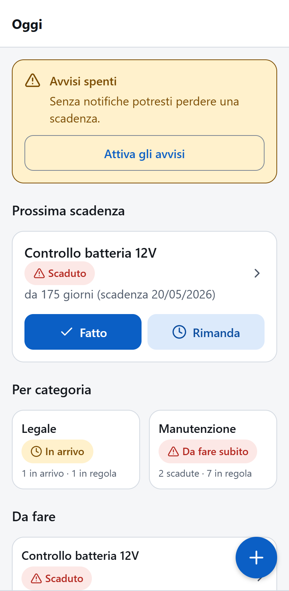
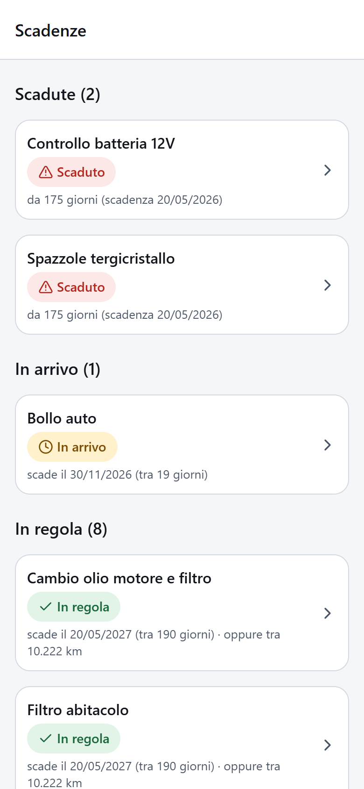
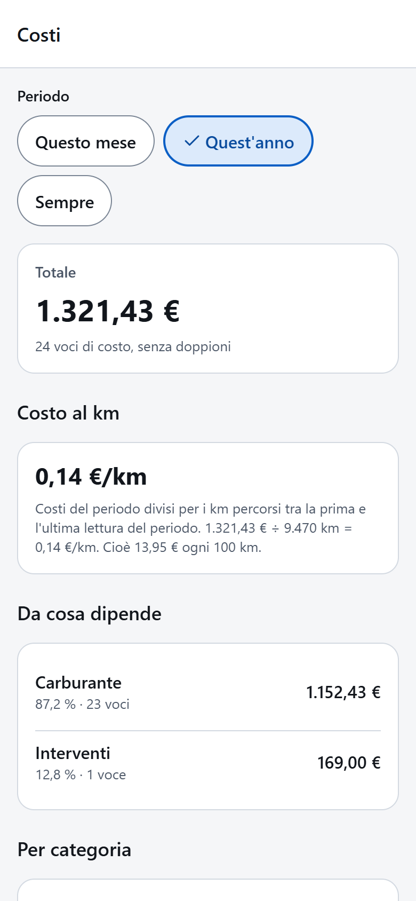
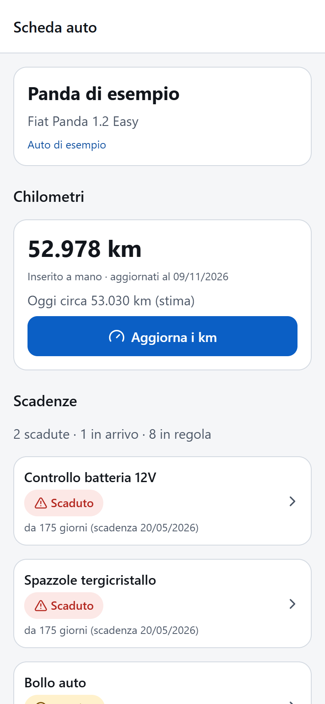
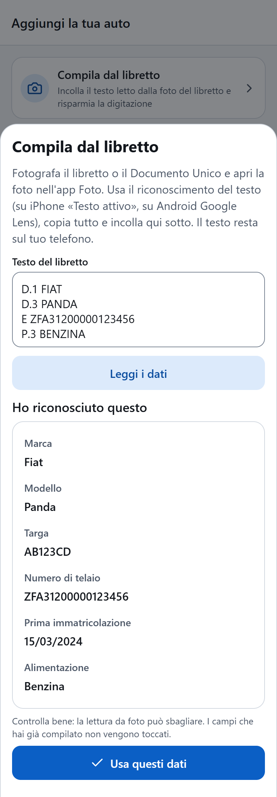
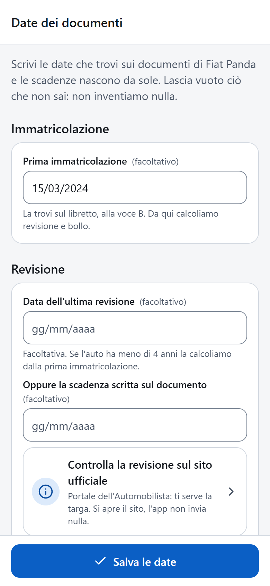

# MyGarage

App per gestire le proprie auto: scadenze (revisione, bollo, assicurazione), tagliandi e
cambio olio, rifornimenti e consumi, spese e costi, controllo dei livelli e documenti, in
un posto solo. Pensata per l'Italia (regole di revisione e bollo, testi in italiano).

**Stato: in sviluppo, non ancora rilasciata.** MyGarage e' il nome di lavoro del progetto.

- **I dati restano sul telefono.** Nessun account, nessun cloud, nessuna pubblicita'.
  Backup e ripristino si fanno da file.
- **Lettura OBD-II via Bluetooth** (in sola lettura): codice e prova con un'auto simulata
  pronti; il collegamento a un adattatore vero **non e' ancora stato provato**.
- **Le scadenze sono promemoria informativi**, calcolati sui dati inseriti: non sostituiscono
  le comunicazioni ufficiali ne' i controlli sul Portale dell'Automobilista, ACI,
  Agenzia delle Entrate o IVASS.

## Com'e' fatta

Schermate dell'anteprima web su formato telefono, con l'auto di esempio e dati inventati
(targa e telaio compresi).

| Oggi | Scadenze | Costi |
| :---: | :---: | :---: |
|  |  |  |
| La prossima scadenza, con **Fatto** e **Rimanda** | Un semaforo per ogni scadenza | Totale, costo al km e da cosa dipende |

| Scheda auto | Compila dal libretto | Date dei documenti |
| :---: | :---: | :---: |
|  |  |  |
| Km e scadenze dell'auto | Legge il testo copiato dalla foto del libretto | Revisione, bollo e assicurazione in una schermata |

## Cosa e' stato provato

- Dominio, dati e casi d'uso: oltre 2300 test automatici (vitest), controllo dei tipi
  (`tsc`) e dei confini tra gli strati (`dependency-cruiser`).
- Interfaccia: provata sul **web** (anche aperta da un iPhone sulla stessa rete Wi-Fi).
- **Non provato su telefono nativo** (notifiche, Bluetooth, fotocamera).

## Come provarla

Servono Node.js 22.13 o piu' recente e npm.

```bash
npm install
npm run web          # anteprima nel browser, con l'auto di esempio
npm test             # test automatici
npm run typecheck    # controllo dei tipi
npm run depcruise    # controllo dei confini tra gli strati
```

Su iPhone **Expo Go non e' utilizzabile**: la versione dell'App Store arriva solo all'SDK 54,
mentre il progetto usa l'SDK 57. Per provare le funzioni native serve una build di sviluppo
(EAS) oppure Expo Go distribuito con TestFlight; in entrambi i casi serve l'Apple Developer
Program. Vedi la documentazione di Expo.

## Struttura

| Cartella | Contenuto |
| --- | --- |
| `src/domain` | Regole pure: date, unita', scadenze, regole italiane, assicurazione, costi |
| `src/data` | Database SQLite, migrazioni, backup e ripristino |
| `src/usecases` | Casi d'uso dell'app (veicoli, scadenze, interventi, assicurazioni, ...) |
| `src/obd` | Lettura OBD-II: parser, sessione ELM, trasporti (simulato e Bluetooth) |
| `src/platform` | Adattatori per dispositivo e web (file, notifiche, orologio) |
| `src/bootstrap` | Composizione dell'app e avvio |
| `src/ui`, `src/app` | Schermate, componenti e rotte (Expo Router) |
| `docs/` | Specifica (`SPEC.md`), ricerche e revisione del codice |
| `tests/` | Test unitari, di integrazione e di regressione |

Tecnologie: Expo SDK 57, React Native 0.86, TypeScript, `expo-sqlite` con SQL scritto a mano,
vitest.

## Licenza

Tutti i diritti riservati: il codice e' visibile ma non puo' essere usato, copiato o
modificato senza permesso. Vedi [`LICENSE`](LICENSE). Per il materiale di terzi vedi
[`THIRD_PARTY_LICENSES.md`](THIRD_PARTY_LICENSES.md).
